<p align="center">
<a href="mailto:dominik.gadzina1@gmail.com"><b>email</b></a> &nbsp;·&nbsp;
<a href="https://www.linkedin.com/in/dominik-gadzina"><b>linkedin</b></a> &nbsp;·&nbsp;
<a href="https://dominikgadzina.vercel.app/"><b>portfolio</b></a>
</p>

<br>



<br>


<table>
<tr>
<td width="50%" valign="top"><a href="https://github.com/Pum2A/screensort-releases/releases"></a></td>
<td width="50%" valign="top"><a href="https://github.com/Pum2A/screensort-releases/releases">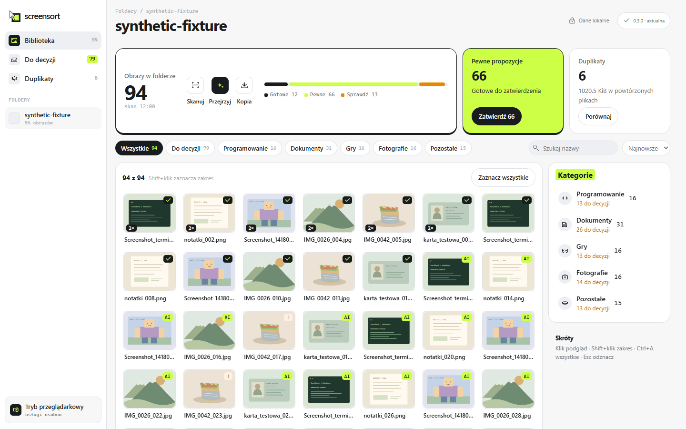</a></td>
</tr>
</table>

<details>
<summary><b>More about ScreenSort</b> — screens and what's under the hood</summary>
<br>

<table>
<tr>
<td width="50%">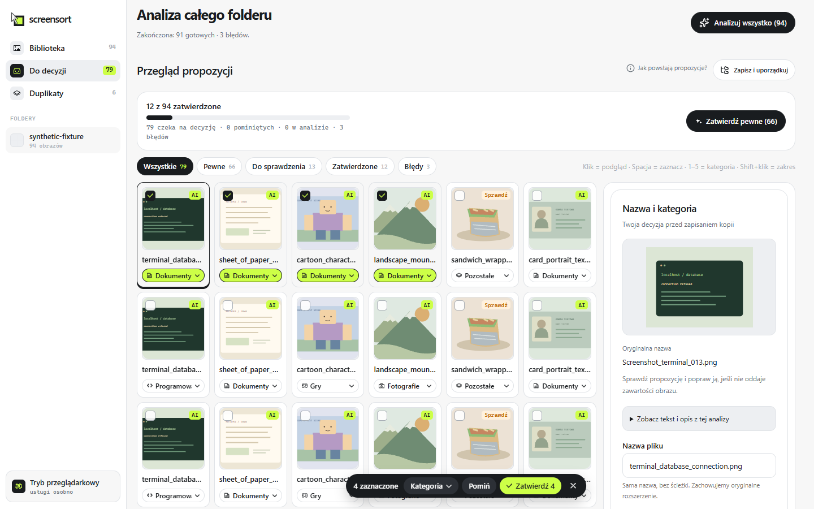</td>
<td width="50%"></td>
</tr>
<tr>
<td><sub>bulk review · keys 1–5 set the category</sub></td>
<td><sub>duplicates · keep one copy, skip the rest</sub></td>
</tr>
</table>

```text
├── Java 25 + Spring Boot 4: background scan jobs, SHA-256 catalog in PostgreSQL, Flyway
├── versioned decisions: a stale form never overwrites a newer one
├── verified copying: every file re-hashed before it is kept
├── local Python service reads text and describes images, nothing is uploaded
├── React 19 + Tauri 2 (Rust): the shell owns every local process, signed updates
└── CI: JUnit + Testcontainers · node:test · cargo test · pytest
```

[Download the Windows preview](https://github.com/Pum2A/screensort-releases/releases) · source is private for now

</details>

<br>



<br>


<table>
<tr>
<td width="33%"><a href="https://github.com/Pum2A/BookSelf"></a></td>
<td width="33%"><a href="https://github.com/Pum2A/DSA"></a></td>
<td width="33%"><a href="https://github.com/Pum2A/Foodify"></a></td>
</tr>
<tr>
<td><a href="https://github.com/Pum2A/ai-chat-app"></a></td>
<td><a href="https://github.com/Pum2A/react-crypto"></a></td>
<td><a href="https://github.com/Pum2A/minecraft-clone"></a></td>
</tr>
</table>
